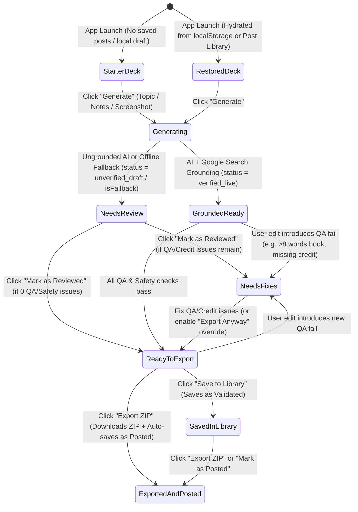

# MARROK TikTok Carousel Studio — UX & Product Audit: Duplication & Confusion

**Product Goal Benchmark:**
A creator provides **ONE input** (topic, text, screenshot, or link) and produces a bilingual (EN+AR) `1080×1920` TikTok carousel, caption, and ZIP of JPGs.
**Target Happy Path:** `Input → Generate → Review/Fix → Pass Checks → Export → (Optionally) Save as Posted` — completable by a first-time user without help on both desktop and mobile (`390px`).

---

## A. Executive Summary

### Top 5 Problems

1. **Dual Competing Action Bars & Quadruple Entry Points (`AutonomousStudio.tsx:1303–1411` vs `ExportBar.tsx:264–389`)**
   Every core delivery and persistence action is rendered at least twice on screen simultaneously. Underneath the canvas (`AutonomousStudio.tsx:1303–1411`), a persistent "Quick Action Bar" renders `JPG`, `Copy`, `Save Valid`, and `Export ZIP`. Simultaneously, inside the right-hand `Caption & QA` tab (`ExportBar.tsx:264–389`), a second "Docked Action & Delivery Bar" renders `JPG`, `Copy`, `Contact Sheet`, and `Export ZIP`, stacked directly beneath a "Backend Post Vault" card with `Save as Valid Post`, `Save & Mark as Posted`, and `Open Vault`. Furthermore, `Contact Sheet` appears in 3 places (`Header.tsx:110`, `Header.tsx:254`, `ExportBar.tsx:338`), and `Saved Posts` / `Vault` appears in 3 places (`Header.tsx:169`, `AutonomousStudio.tsx:1363`, `ExportBar.tsx:276`). Users hesitate over which bar is authoritative.

2. **Four Overlapping & Contradictory Gatekeepers for a Single Readiness State (`ExportBar.tsx:91–261`, `AutonomousStudio.tsx:792`)**
   When a deck is generated via the Ungrounded AI or Offline fallback, the user is confronted in the `Caption & QA` tab by four separate boxes that govern whether export is allowed: (1) the `Synthesis Engine` header with `✓ I reviewed this draft` (`ExportBar.tsx:91–127`), (2) the amber `Unverified Draft — Human Review Required` banner (`ExportBar.tsx:130–151`), (3) the `Creator / Channel Credit` card (`ExportBar.tsx:154–177`), (4) the `Platform Safety & Originality Gate` (`ExportBar.tsx:180–231`), and (5) the `Pre-Export QA & Safety Gate` with its `Override & allow export` checkbox (`ExportBar.tsx:234–261`). Worse, because `qaChecks.ts:768` treats `unverified_draft` without `userReviewed` as a `FAIL` (`fallback-draft-blocker`) while `riskChecks.ts:153–197` only blocks `unverified-numbers` when a slide has metrics, **one gate frequently displays `PASS` in green while the adjacent gate displays `FAIL` in red**, leaving first-time users confused about why export is blocked.

3. **Hidden & Disconnected Blocking Logic on the Primary `Export ZIP` CTA (`AutonomousStudio.tsx:780–801`, `1380–1410`)**
   When the user is on the default `Copy` tab (where they spend 80% of their editing time) and clicks `Export ZIP` under the canvas (`AutonomousStudio.tsx:1380`), the button is styled as an active, clickable amber CTA (`bg-amber-400 text-slate-950`). Clicking it does **not** export; instead, `handleExportZip` (`AutonomousStudio.tsx:792–800`) silently aborts, force-switches the right inspector to `Caption & QA`, force-switches mobile view from `Canvas` to `Editor`, and fires a transient 3.2-second toast. Even more confusingly, clicking `Save Valid` (`AutonomousStudio.tsx:1363` -> `App.tsx:236–247`) is hard-blocked unless `overrideExportBlock` is checked inside the `Caption & QA` tab—with no inline explanation near the `Save Valid` button.

4. **Severe Terminology Fragmentation & Internal Engineering Jargon (`Header.tsx`, `AutonomousStudio.tsx`, `ExportBar.tsx`, `SavedPostsDrawer.tsx`)**
   The same concepts are labeled differently across components:
   - **Copy**: Means "Slide Text Editor" in the first inspector tab (`AutonomousStudio.tsx:1428`), "Copy Slide Image to Clipboard" in both action bars (`AutonomousStudio.tsx:1349`, `ExportBar.tsx:334`), and "Copy Caption" (`AutonomousStudio.tsx:1619`).
   - **Saved Posts**: Called `Saved Posts` (`Header.tsx:176`), `Save Valid` (`AutonomousStudio.tsx:1374`), `Save as Valid Post` / `Update Validated Post` (`ExportBar.tsx:294`), `Backend Post Vault` (`ExportBar.tsx:269`), and `Saved & Posted Vault` (`SavedPostsDrawer.tsx:111`).
   - **Verified Claims**: Called `Verified Claims` (`Header.tsx:129`), `Inspect Plan & Facts` (`Header.tsx:278`), and `Generation Plan & Grounding Inspector` (`PlanInspectorModal.tsx:48`).
   - **Jargon**: `HUD` filter (`ArchetypeControls.tsx:772`), `Vault` (`ExportBar.tsx:269`), `vercel-tmp` / `Browser IndexedDB Cache` (`SavedPostsDrawer.tsx:120`), and `Spec §8` / `Spec §10` (`ExportBar.tsx:342`, `AutonomousStudio.tsx:1693`).

5. **Split Single-Slide Regeneration & Buried Polish Tools (`Header.tsx:184`, `PreviewAndToolsDrawer.tsx:241–346`)**
   Regenerating a single slide's copy or applying a hook variant does not live in the `Copy` tab where the user edits slide copy. Instead, it is hidden inside a top-right header drawer labeled `Preview & Tools` → `Slide Polish` tab (`PreviewAndToolsDrawer.tsx:241–346`), while deck-level regeneration lives in the top command bar (`AutonomousStudio.tsx:1084`) and in `ExportBar.tsx:142` (`Retry with AI`). A user editing Slide 3 in the `Copy` tab has no idea they must open `Preview & Tools` in the global header and switch to `Slide Polish` to rewrite Slide 3.

---

### Top 5 Fixes

1. **Unify Delivery into ONE Persistent Action Bar Under the Canvas (`AutonomousStudio.tsx:1303–1411`) and Remove the Duplicate Bar in `ExportBar.tsx`**
   Delete the duplicate bottom action bar (`ExportBar.tsx:311–389`) and the duplicate `Backend Post Vault` card (`ExportBar.tsx:264–308`) from the `Caption & QA` tab. Keep a single, unified **Delivery Bar** beneath the canvas preview containing: `Download Slide JPG`, `Copy Slide Image`, a split or secondary `Save to Library` action, and the primary `Export ZIP (8 JPGs + Caption)` button.

2. **Replace All 5 Separate Gate Cards in `Caption & QA` with ONE "Ready to Publish" Checklist (`ExportBar.tsx`)**
   Merge the `Synthesis Engine` header, `Unverified Draft` banner, `Creator Credit` input card, `Platform Safety & Originality Gate`, and `Pre-Export QA Gate` into a single **Ready to Publish Checklist** card with 4 clear rows:
   1. **Creator Credit** (inline text input + auto-fill if empty)
   2. **Human Review** (`Mark as Reviewed` one-click button when generated by Ungrounded AI or Offline mode)
   3. **Slide Copy & Layout QA** (per-issue `[Jump to Slide # & Auto-Fix]` buttons)
   4. **TikTok Originality & Safety** (clear pass/fail reason)
   Include a single explicit `Export Anyway (Override Warnings)` toggle at the bottom of the checklist when an advisory/non-critical check fails.

3. **Standardize One Term per Concept Across the Entire UI (Zero Jargon Policy)**
   Rename `Copy` (tab) → **`Slide Text`**; `Copy` (button) → **`Copy Slide Image`**; `Saved Posts` / `Backend Post Vault` / `Save Valid` → **`Post Library`** and **`Save to Library`**; `Verified Claims` / `Inspect Plan & Facts` → **`Sources & Citations`**; `Contact Sheet` → **`All Slides Grid`**; `Preview & Tools` → **`TikTok Preview`**. Strip all internal spec references (`Spec §8`, `Spec §10`, `vercel-tmp`, `HUD`).

4. **Move "Rewrite Slide" & "Hook Variants" Inline into the `Slide Text` Tab (`InlineSlideEditor.tsx`)**
   Move the `Slide Polish` tools (`Hook Variants` for Slide 1 and `Single-Slide AI Rewrite` + `Auto-Fit Copy` for any slide) out of `PreviewAndToolsDrawer.tsx:241–346` and directly into `InlineSlideEditor.tsx` (the `Slide Text` tab), right where the user is editing that slide's text. Repurpose `PreviewAndToolsDrawer` into a focused **`TikTok Feed Preview`** modal/drawer.

5. **Make `Export ZIP` State Visually Honest & Self-Healing**
   When a required check is incomplete (e.g. missing creator credit or unreviewed draft), show the exact count and reason directly on/beside the primary `Export ZIP` button (e.g., `Complete 1 Check to Export →` which opens the `Publish Checklist` tab and scrolls to the exact item with focus), and turn the button solid teal (`Export ZIP`) **only** when all required checks pass (or override is enabled).

---

## State Machine & Readiness State Diagram

The lifecycle of a deck follows 8 discrete states with a single authoritative status label displayed in the UI:

```mermaid
stateDiagram-v2
    [*] --> OfflineDraft: Local Synthesizer Fallback
    [*] --> AIUngrounded: Gemini Schema (No Search Tool)
    [*] --> AIGrounded: Gemini with Google Search

    OfflineDraft --> Reviewed: Creator confirms technical claims
    AIUngrounded --> Reviewed: Creator confirms technical claims
    AIGrounded --> Reviewed: Auto-reviewed (Live Sources Verified)

    OfflineDraft --> Blocked: Missing Credit / Limit Failure / Risk Block
    AIUngrounded --> Blocked: Missing Credit / Limit Failure / Risk Block
    AIGrounded --> Blocked: Missing Credit / Limit Failure / Risk Block

    Reviewed --> Ready: All 4 Checks PASS (or Override enabled)
    Blocked --> Ready: Issues resolved or Override enabled

    Ready --> Saved: Click "Save to Vault"
    Ready --> Posted: Click "Export ZIP" / Marked as Posted
    Saved --> Posted: Click "Export ZIP" / Marked as Posted
    Posted --> [*]

    note right of OfflineDraft: Status: "Offline Synthesizer"
    note right of AIUngrounded: Status: "Ungrounded AI Draft"
    note right of AIGrounded: Status: "Search Grounded"
    note right of Reviewed: Status: "Reviewed"
    note right of Blocked: Status: "Blocked (Actions Needed)"
    note right of Ready: Status: "Ready to Publish"
    note right of Saved: Status: "Saved to Vault"
    note right of Posted: Status: "Posted"
```

| State | Transition Trigger | Condition to Advance | Single Authoritative UI Status Label |
|---|---|---|---|
| **Offline draft** | Local generation fallback | Requires human fact review | `Offline Synthesizer` |
| **AI ungrounded** | LLM schema generation | Requires human fact review | `Ungrounded AI Draft` |
| **AI grounded** | LLM + Google Search | Auto-passes source review if sources present | `Search Grounded` |
| **Reviewed** | Creator clicks `Mark as Reviewed` | Ready if credit, risk, and limits pass | `Reviewed` |
| **Blocked** | Any of 4 checklist items fails | Blocked until resolved or override checked | `Blocked (Actions Needed)` |
| **Ready** | All 4 checklist items PASS or override active | Primary Export button enabled | `Ready to Publish` |
| **Saved** | Creator clicks `Save to Vault` | Persisted in backend / IndexedDB vault | `Saved to Vault` |
| **Posted** | Creator exports bundle or marks posted | Finalized publication state | `Posted` |

---

## B. Complete UI & Status Inventory (Step 1)

| # | Element Label / Indicator | Icon | Location | Component (`file:line`) | What It Does | Enabled / Disabled Condition | State Read / Written |
|---|---|---|---|---|---|---|---|
| 1 | **MARROK** (Brand Wordmark) | `/marrok-logo.svg` | Top Header (Left) | `src/components/Header.tsx:74-81` | Anchor link `#` (no-op navigation) | Always enabled | None |
| 2 | **Undo** (`Ctrl+Z`) | `Undo2` | Top Header (Desktop nav & Mobile menu) | `src/components/Header.tsx:88-96`, `212-223` | Reverts `carousel` to previous snapshot in 30-step ring buffer | Enabled when `pastHistory.length > 0` (`canUndo`) | Reads/Writes `carousel`, `pastHistory`, `futureHistory` (`src/App.tsx:161-176`) |
| 3 | **Redo** (`Ctrl+Y`) | `Redo2` | Top Header (Desktop nav & Mobile menu) | `src/components/Header.tsx:97-105`, `224-235` | Restores `carousel` from `futureHistory` | Enabled when `futureHistory.length > 0` (`canRedo`) | Reads/Writes `carousel`, `pastHistory`, `futureHistory` (`src/App.tsx:178-193`) |
| 4 | **Contact Sheet** | `Grid` | Top Header (Desktop nav & Mobile menu) | `src/components/Header.tsx:109-119`, `254-266` | Opens `ContactSheetModal` showing all slides at `270×480` | Always enabled | Writes `isContactSheetOpen = true` (`src/App.tsx:111`) |
| 5 | **Verified Claims** (Desktop) / **Inspect Plan & Facts** (Mobile) | `FileCheck2` | Top Header (Desktop nav & Mobile menu) | `src/components/Header.tsx:121-131`, `268-280` | Opens `PlanInspectorModal` showing AI claims, grounding URLs, and QA summary | Always enabled | Writes `isPlanInspectorOpen = true` (`src/App.tsx:112`) |
| 6 | **Theme: {Name}** | Color dot | Top Header (Desktop nav & Mobile menu) | `src/components/Header.tsx:133-144`, `239-252` | Opens `ThemeCustomizer` modal for palette & canvas chrome options | Always enabled | Reads `currentPalette`; Writes `isThemeCustomizerOpen = true` |
| 7 | **Draft {HH:MM}** / **Saved {HH:MM}** | None | Top Header (Desktop `xl` & Mobile menu) | `src/components/Header.tsx:146-148`, `282-284` | Status indicator showing last `localStorage` auto-save timestamp | Rendered when `lastSavedTime !== null` | Reads `lastSavedTime` (`src/App.tsx:62, 83`) |
| 8 | **Reset** | `RotateCcw` (mobile) | Top Header (Next to Draft time & Mobile menu) | `src/components/Header.tsx:152-160`, `285-297` | Resets deck to `DEFAULT_STARTER_DECK` and clears `marrok_deck_draft_v1` | Rendered when `lastSavedTime !== null` | Writes `carousel`, clears `localStorage` (`src/App.tsx:214-224`) |
| 9 | **Saved Posts ({count})** | `BookmarkCheck` | Top Header (Right Zone) | `src/components/Header.tsx:168-181` | Opens `SavedPostsDrawer` (Backend + IndexedDB Vault) | Always enabled | Reads `savedPosts.length`; Writes `isSavedPostsDrawerOpen = true` |
| 10 | **Preview & Tools** | `Smartphone` | Top Header (Right Zone) | `src/components/Header.tsx:183-194` | Opens `PreviewAndToolsDrawer` on `'simulator'` tab | Always enabled | Writes `isPreviewDrawerOpen = true`, `previewDrawerTab = 'simulator'` |
| 11 | **More Options** (Mobile Overflow) | `MoreVertical` / `X` | Top Header (`< md` screens) | `src/components/Header.tsx:198-206` | Toggles mobile dropdown menu | Visible `< md` | Reads/Writes `isMobileMenuOpen` |
| 12 | **Topic / Notes Input** | `Sparkles` | Command Bar (Top of Studio) | `src/components/AutonomousStudio.tsx:1035-1042` | Text input for topic/notes; auto-expands drawer if `> 200` chars | Disabled when `isGenerating === true` | Reads/Writes `promptInput`, `isExpanded` |
| 13 | **Attached Image Pill & Clear (`X`)** | `ImageIcon`, `X` | Command Bar (Inside input row) | `src/components/AutonomousStudio.tsx:1044-1056` | Displays attached screenshot filename and removes it on click | Rendered when `uploadedImage !== null` | Reads/Writes `uploadedImage` |
| 14 | **Clear Input (`X`)** | `X` | Command Bar (Inside input row) | `src/components/AutonomousStudio.tsx:1058-1067` | Clears `promptInput` text and `uploadedImage` | Rendered when `(promptInput \|\| uploadedImage) && !isGenerating` | Writes `promptInput = ''`, `uploadedImage = null` |
| 15 | **Engine Status Badge (`Grounded` / `Offline` / `Ungrounded AI`)** | None | Command Bar (Right of input) | `src/components/AutonomousStudio.tsx:772-777`, `1071-1075` | Read-only badge showing current deck synthesis provenance | Always visible (`hidden md:inline-flex`) | Reads `carousel.sourceMeta.engine`, `status`, `isFallback` |
| 16 | **Source / OCR** Drawer Toggle | `SlidersHorizontal`, `ChevronUp`/`Down` | Command Bar | `src/components/AutonomousStudio.tsx:1077-1091` | Expands/collapses the overlay ingestion drawer (Notes, YouTube, Screenshot, Category, Starters) | Always enabled | Reads/Writes `isExpanded` |
| 17 | **Generate** / **Generating...** | `RefreshCw` / `Wand2` | Command Bar | `src/components/AutonomousStudio.tsx:1093-1112` | Runs `handleRunAutonomousPipeline()` (`POST /api/generate` -> offline fallback) | Disabled when `isGenerating \|\| (!promptInput.trim() && !uploadedImage)` | Reads `promptInput`, `uploadedImage`, `isGenerating`; Writes `carousel`, `isGenerating`, `pipelineStatus` |
| 18 | **Pipeline Status Banner** | Pulsing dot + `Zap` | Below Command Bar (during generation) | `src/components/AutonomousStudio.tsx:1115-1135` | Shows live status string (`pipelineStatus`) + **Skip Wait → Instant Offline Mode** button | Rendered only when `isGenerating && pipelineStatus` | Reads `isGenerating`, `pipelineStatus`; Button aborts fetch & runs `handleInstantSynthesize` |
| 19 | **Ingestion Mode Tabs (`Topic / Notes`, `YouTube Transcript`, `Screenshot / OCR`)** | `FileText`, `Youtube`, `Upload` | Command Bar Overlay Drawer | `src/components/AutonomousStudio.tsx:1144-1180` | Switches `activeTab` input mode and placeholder instructions | Visible when `isExpanded === true` | Reads/Writes `activeTab` (`'text' \| 'youtube' \| 'upload'`) |
| 20 | **Category Override Select** | None | Command Bar Overlay Drawer | `src/components/AutonomousStudio.tsx:1183-1197` | Sets `categoryHint` (`auto`, `ai`, `cloud`, `security`, `devtools`, `web`, `hardware`) | Visible when `isExpanded === true` | Reads/Writes `categoryHint` |
| 21 | **Instant Offline** | `Zap` | Command Bar Overlay Drawer | `src/components/AutonomousStudio.tsx:1200-1208` | Synthesizes 8-slide deck locally in 0ms via `synthesizeCarousel()` | Visible when `isExpanded === true` | Writes `carousel`, `isExpanded = false` |
| 22 | **Clear** (Dock) | None | Command Bar Overlay Drawer | `src/components/AutonomousStudio.tsx:1209-1218` | Resets `promptInput`, `uploadedImage`, and `categoryHint` | Visible when `isExpanded && (promptInput \|\| uploadedImage)` | Writes `promptInput`, `uploadedImage`, `categoryHint` |
| 23 | **Close (`X`)** (Dock) | `X` | Command Bar Overlay Drawer | `src/components/AutonomousStudio.tsx:1219-1226` | Closes ingestion overlay drawer | Visible when `isExpanded === true` | Writes `isExpanded = false` |
| 24 | **Long-Form Textarea / Screenshot Dropzone & Sample Buttons** | `Upload`, `CheckCircle` | Command Bar Overlay Drawer | `src/components/AutonomousStudio.tsx:1229-1292` | Multiline notes input OR image file picker + 2 demo screenshot buttons | Visible when `isExpanded === true` | Reads/Writes `promptInput` or `uploadedImage` |
| 25 | **1-Click Starter Topics** (4 chips) | None | Command Bar Overlay Drawer Footer | `src/components/AutonomousStudio.tsx:1295-1314` | Populates `promptInput` with a preset prompt and immediately triggers `handleRunAutonomousPipeline` | Disabled when `isGenerating === true` | Writes `promptInput`, triggers generation |
| 26 | **Mobile Mode Switcher (`Canvas Preview` / `Slide Editor`)** | `Layers`, `SlidersHorizontal` | Mobile Segmented Bar (`< lg`) | `src/components/AutonomousStudio.tsx:1322-1350` | Toggles between Canvas column and Inspector column on mobile viewports | Visible only on `< lg` screens | Reads/Writes `mobileStudioTab` (`'canvas' \| 'editor'`) |
| 27 | **1080×1920 Interactive Canvas** | Canvas + Selection Overlay | Left Column (`ViewportCanvas`) | `src/components/studio/ViewportCanvas.tsx:314-466` | Renders current slide; supports click hit-testing, collision-clamped drag, and arrow-key micro-nudging (`10px` / `25px` with Shift) | Always interactive | Reads `carousel`, `currentSlideIndex`, `theme`, `showSafeZones`, `selectedElementId`; Writes `layoutOverrides`, `selectedElementId` |
| 28 | **Selected Layer HUD Pill (`Layer: {Label}` + `Reset` + `Deselect`)** | `Move`, `RotateCcw` | Top-Left Overlay inside Canvas | `src/components/studio/ViewportCanvas.tsx:469-504` | Shows currently selected canvas graphical element; `Reset` clears its `dx/dy/scale`; `Deselect` clears selection | Rendered when `selectedElementId !== null` | Reads/Writes `selectedElementId`, `slide.layoutOverrides` |
| 29 | **Prev / Next Slide Buttons (`<` / `>`)** | `ChevronLeft`, `ChevronRight` | Below Canvas (`SlideNavigator`) | `src/components/studio/SlideNavigator.tsx:48-84` | Navigates to previous or next slide (also bound to global `ArrowLeft`/`ArrowRight`) | Prev disabled at `0`; Next disabled at `slides.length - 1` | Reads/Writes `currentSlideIndex`, `activeSlideIndex` |
| 30 | **Move Left / Move Right** | `ArrowLeft`, `ArrowRight` | Below Canvas (`SlideNavigator`) | `src/components/studio/SlideNavigator.tsx:89-111` | Reorders current slide left or right in the deck | Disabled at deck boundaries (`0` or `slides.length - 1`) | Writes `carousel.slides`, `currentSlideIndex` |
| 31 | **Add Slide** | `Plus` | Below Canvas (`SlideNavigator`) | `src/components/studio/SlideNavigator.tsx:113-122` | Inserts a new `row` slide after current slide | Always enabled | Writes `carousel.slides`, `currentSlideIndex` |
| 32 | **Clone Slide** | `CopyPlus` | Below Canvas (`SlideNavigator`) | `src/components/studio/SlideNavigator.tsx:124-133` | Duplicates current slide at `currentSlideIndex + 1` | Always enabled | Writes `carousel.slides`, `currentSlideIndex` |
| 33 | **Delete Slide** | `Trash2` | Below Canvas (`SlideNavigator`) | `src/components/studio/SlideNavigator.tsx:135-145` | Deletes current slide (blocked with toast if `slides.length <= 3`) | Disabled when `slides.length <= 3` | Writes `carousel.slides`, `currentSlideIndex` |
| 34 | **Safe Zones Toggle** | `ShieldAlert` | Below Canvas (`SlideNavigator`) | `src/components/studio/SlideNavigator.tsx:149-162` | Toggles red TikTok UI occlusion overlay on the canvas (`x > 945`, `y > 1710`) | Always enabled | Reads/Writes `showSafeZones` |
| 35 | **Slide Strip Pills (`1 HOOK`, `2 ROW`, ...)** | QA dot (red/amber) | Below Canvas (`SlideNavigator`) | `src/components/studio/SlideNavigator.tsx:166-214` | Jumps directly to slide `#`; displays red dot if slide has QA `fail` or amber dot if `warn` | Always enabled | Reads `currentSlideIndex`, `qaReport`; Writes `currentSlideIndex` |
| 36 | **Quick Action Bar: `JPG`** | `Download` | Below Slide Navigator (Left Column) | `src/components/AutonomousStudio.tsx:1372-1381` | Downloads current slide as `1080×1920` JPG (`Q95`) | Always enabled | Reads `carousel`, `currentSlideIndex`, `theme` |
| 37 | **Quick Action Bar: `Copy`** | `Copy` / `Check` | Below Slide Navigator (Left Column) | `src/components/AutonomousStudio.tsx:1383-1396` | Copies current slide bitmap (`PNG` blob) to system clipboard | Always enabled | Reads `carousel`, `currentSlideIndex`; Writes `copiedType = 'slide'` |
| 38 | **Quick Action Bar: `Save Valid` / `Saved`** | `BookmarkCheck` | Below Slide Navigator (Left Column) | `src/components/AutonomousStudio.tsx:1398-1413` | Saves deck with status `'validated'` to Backend + IndexedDB Vault (if QA/Risk pass or override is checked) | Disabled when `isSavingPost === true` | Reads `carousel.id`, `isSavingPost`, `overrideExportBlock`; Writes `savedPosts`, `carousel.id` |
| 39 | **Quick Action Bar: `Export ZIP`** | `Download` / `RefreshCw` + `⚠️ {count}` | Below Slide Navigator (Left Column) | `src/components/AutonomousStudio.tsx:1416-1446` | Exports all slides + Metricool bundle as ZIP and auto-saves as `'posted'`. **If blocked, switches tab to `Caption & QA` and shows toast.** | Disabled when `isExportingZip === true` (Amber when blocked, Teal when ready) | Reads `qaReport`, `riskReport`, `overrideExportBlock`, `isExportingZip`; Writes `inspectorTab = 'caption'` if blocked |
| 40 | **Inspector Tabs (`Copy`, `Visual Layout`, `Position`, `Caption & QA`)** | `FileText`, `Palette`, `Move`, `CheckCircle` | Right Column Header | `src/components/AutonomousStudio.tsx:1455-1531` | Switches active inspector panel; `Position` shows active override count; `Caption & QA` shows red/amber/green dot | Always enabled | Reads/Writes `inspectorTab` (`'copy' \| 'visual' \| 'position' \| 'caption'`) |
| 41 | **Slide Archetype Bar (8 pills: `Hub`, `Row`, `Number`, `Metric`, `Code`, `Compare`, `Image`, `CTA`)** | Archetype icons | Top of `Copy` Tab (`InlineSlideEditor`) | `src/components/studio/InlineSlideEditor.tsx:66-92` | Changes `currentSlide.type` and seeds missing archetype fields via `seedSlideArchetypeData()` | Always enabled | Reads `slide.type`; Writes `slide` (`handleSetSlideType`) |
| 42 | **EN Title / AR Title / EN Body / AR Body Inputs** | Character count badges (`42/45`) | `Copy` Tab (`InlineSlideEditor`) | `src/components/studio/InlineSlideEditor.tsx:95-218` | Edits bilingual slide copy with live character counters (turns amber over limit) | Always enabled | Reads/Writes `slide.enTitle`, `arTitle`, `enBody`, `arBody` |
| 43 | **Auto-Fit Copy Button** | `Wand2` | `Copy` Tab (`InlineSlideEditor` header, when over limit) | `src/components/studio/InlineSlideEditor.tsx:101-112` | Truncates/polishes slide copy to Spec §8 character limits and fixes Arabic BiDi punctuation | Rendered only when `isOverLimit === true` | Writes `slide.enTitle`, `arTitle`, `enBody`, `arBody` |
| 44 | **Archetype-Specific Fields (`Number`, `Metric`, `Code`, `Compare`, `CTA`, `Credit`)** | Various | `Copy` Tab (`InlineSlideEditor`) | `src/components/studio/InlineSlideEditor.tsx:221-445` | Edits `number`, `metricValue`/`Label`/`Diff`/`Subtext`, `codeLanguage`/`codeSnippet`, `compareLeft*`/`Right*`, `ctaText`, `enCredit`/`arCredit` | Rendered conditionally based on `slide.type` | Reads/Writes corresponding `SlideData` fields |
| 45 | **Schematic Diagram Variant Grid (9 variants)** | Variant icons | `Visual Layout` Tab (`ArchetypeControls`) | `src/components/studio/ArchetypeControls.tsx:287-332` | Selects schematic diagram (`None`, `Topology`, `Stack`, `Isolation`, `Takeaway`, `Scatter`, `Graph`, `Clusters`, `Split`, `Features`) | Always enabled | Reads/Writes `slide.diagramVariant` |
| 46 | **Diagram Nodes / Orbital Hub / Icon Picker / Image Cover Controls** | Searchable icon grid, `Wand2`, `FolderSearch` | `Visual Layout` Tab (`ArchetypeControls`) | `src/components/studio/ArchetypeControls.tsx:335-805` | Edits orbital hub nodes (`satLabels`, `satIcons`, `centerIcon`), diagram nodes/edges, row icons, or opens `SlideImageStudio` / `MediaSearchModal` | Conditional on `slide.type` and `slide.diagramVariant` | Reads/Writes `slide.*`; Opens `SlideImageStudio` or `MediaSearchModal` |
| 47 | **Element Position & Scale Sliders (`dx`, `dy`, `scale`, `opacity`)** | `Move`, `RotateCcw`, `CopyCheck` | `Position` Tab (`ElementInspector`) | `src/components/studio/ElementInspector.tsx:62-254` | Selects a canvas layer (`Header`, `Graphic`, `EN Title`, `AR Title`, `EN Body`, `AR Body`, `Footer`), adjusts `dx`/`dy`/`scale`/`opacity`, resets layer/slide, or applies to all slides | Always enabled | Reads/Writes `selectedElementId`, `slide.layoutOverrides` |
| 48 | **TikTok Caption Textarea & `Copy Caption` Button** | `Copy` / `Check`, `Hash` | Top of `Caption & QA` Tab (`AutonomousStudio`) | `src/components/AutonomousStudio.tsx:1601-1657` | Edits `carousel.caption`, displays auto-generated topic hashtags, and copies caption + hashtags to clipboard | Always enabled | Reads/Writes `carousel.caption`, `copiedType = 'caption'` |
| 49 | **Synthesis Engine Badge & `✓ I reviewed this draft` Button** | `CheckCircle` | `Caption & QA` Tab (`ExportBar`) | `src/components/studio/ExportBar.tsx:91-127` | Shows engine (`Grounded`, `Ungrounded AI Draft`, `Offline Synthesizer Draft`) and toggles `carousel.sourceMeta.userReviewed` | Always enabled | Reads/Writes `carousel.sourceMeta.userReviewed` |
| 50 | **Unverified Draft Warning Banner & `Retry with AI` Button** | `RefreshCw` | `Caption & QA` Tab (`ExportBar`) | `src/components/studio/ExportBar.tsx:130-151` | Warns that human review is required; `Retry with AI` re-runs `handleRunAutonomousPipeline()` | Rendered when `(isOfflineDraft \|\| engineType !== 'grounded') && !isReviewed` | Reads `isOfflineDraft`, `engineType`, `isReviewed`; Triggers generation |
| 51 | **Creator / Channel Credit Input Card** | Status pill (`✓ Credited` / `Required before export`) | `Caption & QA` Tab (`ExportBar`) | `src/components/studio/ExportBar.tsx:154-177` | Edits creator/channel attribution across `sourceMeta.creator`, `channel`, and CTA slide `enCredit`/`arCredit` | Always enabled | Reads/Writes `carousel.sourceMeta.creator`, `carousel.channel`, `ctaSlide.enCredit`/`arCredit` |
| 52 | **Platform Safety & Originality Gate Card (`PASS` / `WARN` / `BLOCK`)** | `ShieldCheck` / `ShieldAlert` | `Caption & QA` Tab (`ExportBar`) | `src/components/studio/ExportBar.tsx:180-231` | Displays 5 platform risk checks (`Originality`, `Copyright`, `First-Frame`, `Numeric Claims`, `Repetition`) | Always rendered | Reads `riskReport` (`src/lib/riskChecks.ts`) |
| 53 | **Pre-Export QA & Safety Gate Card + `Override & allow export` Checkbox** | Checkbox | `Caption & QA` Tab (`ExportBar`) | `src/components/studio/ExportBar.tsx:234-261` | Lists up to 4 QA failures and provides checkbox to bypass QA/Risk blocks | Rendered when `qaReport.failCount > 0 \|\| riskReport.status === 'BLOCK'` | Reads `qaReport`, `riskReport`; Writes `overrideExportBlock` |
| 54 | **Backend Post Vault Card (`Open Vault`, `Save as Valid Post`, `Save & Mark as Posted`)** | `BookmarkCheck`, `Send` | `Caption & QA` Tab (`ExportBar`) | `src/components/studio/ExportBar.tsx:264-308` | Opens `SavedPostsDrawer`, saves post as `'validated'`, or saves post as `'posted'` | Disabled when `isSavingPost === true` | Reads `carousel.id`, `isSavingPost`; Writes `savedPosts`, `carousel.id` |
| 55 | **Docked Action & Delivery Bar (`JPG`, `Copy`, `Contact Sheet`, `Export ZIP`)** | `Download`, `Copy`, `Grid` | Bottom of `Caption & QA` Tab (`ExportBar`) | `src/components/studio/ExportBar.tsx:311-389` | **Duplicate** of items #36, #37, #4, and #39 | `Export ZIP` disabled during export | Same as #36, #37, #4, #39 |
| 56 | **Detailed Pre-Export QA Checklist (Collapsible list + `[Slide #]` jump buttons)** | `CheckCircle`, `AlertTriangle` | Bottom of `Caption & QA` Tab (`AutonomousStudio`) | `src/components/AutonomousStudio.tsx:1686-1755` | Lists all QA `fail` and `warn` items from `qaReport`; clicking `[Slide #]` jumps to that slide and switches to `Copy` tab | Always rendered in `Caption & QA` tab | Reads `qaReport`; Writes `currentSlideIndex`, `inspectorTab = 'copy'` |
| 57 | **Preview & Tools Drawer (`TikTok Feed Simulator` & `Slide Polish` Tabs)** | `Smartphone`, `Wand2`, `Heart`, `MessageCircle`, `Bookmark`, `Share2` | Slide-Over Right Drawer (`PreviewAndToolsDrawer`) | `src/components/studio/PreviewAndToolsDrawer.tsx:86-355` | Tab 1 simulates TikTok mobile feed overlay; Tab 2 provides Hook Variants (Slide 1), Single-Slide AI Rewrite (`POST /api/generate-slide`), and Auto-Fit Copy | Opened via Header `Preview & Tools` button | Reads/Writes `carousel.slides[currentSlideIndex]`, `currentSlideIndex` |
| 58 | **Saved & Posted Vault Drawer** | `BookmarkCheck`, `Upload`, `Download`, `Trash2`, `FolderOpen` | Slide-Over Right Drawer (`SavedPostsDrawer`) | `src/components/studio/SavedPostsDrawer.tsx:96-339` | Lists saved posts (`All`, `Posted`, `Validated`), saves current deck, loads a saved deck into studio, toggles `Validated`/`Posted`, deletes posts, exports/imports JSON backup | Opened via Header `Saved Posts` or `ExportBar` `Open Vault` | Reads/Writes `savedPosts`, `carousel`, `storageEngine` |
| 59 | **Contact Sheet Modal** | `Grid`, `Download`, `CheckCircle`, `AlertTriangle` | Modal (`ContactSheetModal`) | `src/components/ContactSheetModal.tsx:130-285` | Renders all slides at `270×480` in a grid, downloads full contact sheet JPG (`Q95`), or jumps to any clicked slide | Opened via Header or `ExportBar` `Contact Sheet` | Reads `carousel`, `theme`, `qaReport`; Writes `activeSlideIndex` |
| 60 | **Plan & Grounding Inspector Modal** | `FileCheck2`, `ExternalLink`, `ShieldCheck` | Modal (`PlanInspectorModal`) | `src/components/PlanInspectorModal.tsx:40-265` | Displays generation engine provenance, extracted facts, Google Search citation links, and QA status | Opened via Header `Verified Claims` | Reads `carousel`, `qaReport` |
| 61 | **Theme & Visual Options Customizer Modal** | `Palette`, `Key` | Modal (`ThemeCustomizer`) | `src/components/ThemeCustomizer.tsx:31-235` | Selects theme palette (`Teal`, `Gold`, `Crimson`, `Violet`, `Emerald`, `Amber`), toggles background grid / atmospheric glow / watermark, or opens `ApiKeyModal` | Opened via Header `Theme` button | Reads/Writes `currentPalette`, `carousel.theme`, `carousel.visualOptions` |
| 62 | **Global Toast Banner** | Dark pill | Fixed Bottom-Right (`z-50`) | `src/App.tsx:467-473` | Displays transient 3.2-second feedback messages (`toastMessage`) | Rendered when `toastMessage !== null` | Reads `toastMessage` |

---

## C. Duplication Matrix (Step 2)

| Group | Duplicate / Overlapping Elements & Locations | Recommendation | Where the Survivor Lives & Rationale |
|---|---|---|---|
| **2a. Export, Copy, JPG & Contact Sheet Bars** | 1. **Under-Canvas Quick Action Bar** (`AutonomousStudio.tsx:1369–1447`): `JPG`, `Copy`, `Save Valid`, `Export ZIP`<br>2. **Right-Panel Docked Action Bar** (`ExportBar.tsx:311–389`): `JPG`, `Copy`, `Contact Sheet`, `Export ZIP`<br>3. **Header Nav & Mobile Menu** (`Header.tsx:109–119`, `254–266`): `Contact Sheet` | **KEEP ONE** action bar (under canvas) + **REMOVE** `ExportBar.tsx:311–389` + **MOVE** `Contact Sheet` (`All Slides Grid`) to `SlideNavigator` | Keep the single **Delivery Bar** directly below the canvas (`AutonomousStudio.tsx:1369–1447`) so export actions are always visible regardless of which inspector tab is open. Remove the duplicate bar in `ExportBar.tsx`. Move `All Slides Grid` (`Contact Sheet`) into `SlideNavigator.tsx` right next to the slide strip (where multi-slide navigation belongs) and remove it from both `Header.tsx` and `ExportBar.tsx`. |
| **2b. Save & Vault Controls** | 1. **Header**: `Saved Posts ({count})` (`Header.tsx:168–181`)<br>2. **Under-Canvas Bar**: `Save Valid` (`AutonomousStudio.tsx:1398–1413`)<br>3. **Caption & QA Tab**: `Backend Post Vault` card with `Open Vault`, `Save as Valid Post`, `Save & Mark as Posted` (`ExportBar.tsx:264–308`)<br>4. **Inside `SavedPostsDrawer`**: `Save Validated` & `Save & Mark Posted` (`SavedPostsDrawer.tsx:157–181`) | **MERGE** into 2 clear touchpoints; **REMOVE** `ExportBar.tsx:264–308` | 1. **Header**: Keep `Post Library ({count})` (`Header.tsx:168`) to browse/restore saved carousels.<br>2. **Under-Canvas Delivery Bar**: Keep one `Save to Library` button (and automatic save-on-export with an inline `Mark as Posted` toggle inside the drawer). Delete the redundant `Backend Post Vault` card from `ExportBar.tsx:264–308`. |
| **2c. Inspection & Preview Drawers/Modals** | 1. **Header**: `Preview & Tools` (`Header.tsx:183–194` → `PreviewAndToolsDrawer.tsx`)<br>2. **Header**: `Contact Sheet` (`Header.tsx:109–119` → `ContactSheetModal.tsx`)<br>3. **Header**: `Verified Claims` (`Header.tsx:121–131` → `PlanInspectorModal.tsx`)<br>4. **Inspector**: `Caption & QA` tab (`AutonomousStudio.tsx:1505–1530`) | **MERGE & RELOCATE** | - Move `Slide Polish` (Hook Variants, Single-Slide Rewrite, Auto-Fit) out of `PreviewAndToolsDrawer` into the **`Slide Text`** tab (`InlineSlideEditor.tsx`).<br>- Move `Verified Claims` (Grounding Sources & Extracted Claims) into a collapsible **Sources & Citations** section inside the **`Publish Checklist`** (`Caption & QA`) tab, removing `Verified Claims` from the top header.<br>- Rename `Preview & Tools` to **`TikTok Preview`** (focused purely on the mobile feed simulator). |
| **2d. Overloaded "Copy" Label** | 1. **Inspector Tab 1**: `Copy` (`AutonomousStudio.tsx:1464` — means text/copywriting)<br>2. **Under-Canvas Bar**: `Copy` (`AutonomousStudio.tsx:1395` — means copy slide image to clipboard)<br>3. **Right-Panel Bar**: `Copy` (`ExportBar.tsx:334` — means copy slide image to clipboard)<br>4. **Caption Card**: `Copy Caption` (`AutonomousStudio.tsx:1625` — copies text caption) | **RENAME ALL** (Disambiguate noun vs verb) | - Rename Inspector Tab 1 from `Copy` → **`Slide Text`**.<br>- Rename image clipboard button from `Copy` → **`Copy Image`**.<br>- Keep **`Copy Caption`** on the caption textarea. |
| **2e. Overlapping Gates, Warnings & Checkboxes** | 1. `Synthesis Engine` bar + `✓ I reviewed this draft` (`ExportBar.tsx:91–127`)<br>2. `Unverified Draft — Human Review Required` banner (`ExportBar.tsx:130–151`)<br>3. `Creator / Channel Credit` card (`ExportBar.tsx:154–177`)<br>4. `Platform Safety & Originality Gate` (`ExportBar.tsx:180–231`)<br>5. `Pre-Export QA & Safety Gate` + `Override & allow export` checkbox (`ExportBar.tsx:234–261`)<br>6. `Pre-Export QA Checklist` card (`AutonomousStudio.tsx:1686–1755`)<br>7. `⚠️ {failCount}` badge on `Export ZIP` (`AutonomousStudio.tsx:1435`, `ExportBar.tsx:377`) | **MERGE INTO ONE** `Ready to Publish` Checklist | Replace the 6 stacked cards in `Caption & QA` (`ExportBar.tsx:91–261` + `AutonomousStudio.tsx:1686–1755`) with **ONE unified "Ready to Publish" Checklist** containing 4 actionable rows (Creator Credit, Human Review, Slide QA Checks with `[Jump & Fix]`, and Platform Safety) + 1 bottom `Export Anyway (Override)` toggle. |
| **2f. Scattered Status Indicators** | 1. Command Bar `engineBadge` (`AutonomousStudio.tsx:1071`)<br>2. Command Bar `Generating...` button + `pipelineStatus` banner (`AutonomousStudio.tsx:1093–1135`)<br>3. Header `Draft {HH:MM}` (`Header.tsx:147`)<br>4. `ExportBar` `Synthesis Engine` pill (`ExportBar.tsx:97`)<br>5. `ExportBar` `Unverified Draft` banner (`ExportBar.tsx:130`)<br>6. Global bottom-right Toast (`App.tsx:467`) | **CONSOLIDATE** | - Keep **1 deck provenance pill** in the Command Bar (`Grounded AI`, `AI Draft`, or `Offline Draft`).<br>- Keep **1 readiness status pill** on the `Publish Checklist` tab and `Export ZIP` button.<br>- Keep `Draft saved {HH:MM}` subtly in the header.<br>- Remove the duplicate `Synthesis Engine` card and duplicate `Unverified Draft` banner inside `ExportBar.tsx`. |

---

## D. Confusion Log (Step 3)

### D.1 Contradictory Gate Analysis (Code-Verified Root Causes)

Before listing individual confusion entries, here are the **3 exact code-level contradictions** where one gate tells the user `PASS` while another gate says `BLOCK` / `FAIL`:

1. **Unverified Draft Without Numeric Claims (`qaChecks.ts:768` vs `riskChecks.ts:153–197`)**
   - **What happens**: When a deck is generated via Ungrounded AI (`status: 'unverified_draft'`) or Offline fallback (`isFallback: true`) and has no `%`/`x`/`ms` numbers on slides, `runPlatformRiskChecks()` (`src/lib/riskChecks.ts:160–166`) marks `Numeric Claims & Benchmarks` as **`PASS`**, so the **Platform Safety & Originality Gate** header displays a green **`PASS`** badge (`ExportBar.tsx:194`). Directly below it, `runQAChecks()` (`src/lib/qaChecks.ts:768–777`) triggers `fallback-draft-blocker` (`severity: 'fail'`), so the **Pre-Export QA & Safety Gate** displays red **`1 QA fail`**.
   - **User Impact**: The user sees a green `ShieldCheck` `PASS` card immediately above a red `Pre-Export QA & Safety Gate (1 QA fail, 0 risk block)` card for the exact same unreviewed-draft state.

2. **Creator Credit Checked in 3 Different Ways (`AutonomousStudio.tsx:782` vs `riskChecks.ts:56` vs `qaChecks.ts:426`)**
   - **`AutonomousStudio.tsx:782–790` & `ExportBar.tsx:67–74`**: Checks `carousel.sourceMeta?.creator || carousel.sourceMeta?.channel || carousel.channel || ctaSlide?.enCredit`.
   - **`riskChecks.ts:56–60` (`checkOriginality`)**: Checks `(carousel.channel) || (carousel.brand) || (ctaSlide?.enCredit)`. Notice it checks `carousel.brand` (which `DEFAULT_STARTER_DECK` sets to `'MARROK'`) even when `sourceMeta.creator` and `ctaSlide.enCredit` are empty!
   - **`qaChecks.ts:426–444` (`checkCreditPresence`)**: Checks `!cta.enCredit && !cta.arCredit` and only emits `severity: 'warn'` (never `fail`).
   - **User Impact**: If `carousel.brand` is `'MARROK'` but `ctaSlide.enCredit` and `carousel.channel` are cleared, `riskChecks.ts` says **`PASS`**, `qaChecks.ts` says **`WARN`** (`canExport: true`), yet `ExportBar.tsx:74` (`hasCreatorCredit`) evaluates to `false` ("Required before export") and **blocks `Export ZIP` anyway** (`AutonomousStudio.tsx:792`)!

3. **Save Valid Blocked Without Any Local Explanation (`AutonomousStudio.tsx:1398` → `App.tsx:236–247`)**
   - **What happens**: The user clicks `Save Valid` under the canvas (`AutonomousStudio.tsx:1398`). `App.tsx:236–247` runs `runQAChecks` and `runPlatformRiskChecks` and checks `!overrideExport`. If any check fails (such as clicking `I reviewed this draft` not yet done), `App.tsx:241` aborts with a toast (`Cannot save to Validated Vault: Fix X QA / Y Risk issue(s) first`) **without switching tabs or showing where the issue is**.

---

### D.2 Heuristic & UX Confusion Log

| ID | Screen / Area | Problem Description | Nielsen Heuristic | Severity | Code Evidence (`file:line`) | Suggested Fix | Effort |
|---|---|---|---|---|---|---|---|
| **C-01** | Left Column (`Quick Action Bar`) & Right Column (`Caption & QA`) | **Amber `Export ZIP` looks enabled when blocked, then hijacks navigation on click.** When blocked, `Export ZIP` is bright amber (`bg-amber-400 text-slate-950`) and clickable. Clicking it does not export—it teleports the user to `Caption & QA` and fires a toast. | #1 Visibility of System Status / #4 Consistency | **S1 Blocker** | `src/components/AutonomousStudio.tsx:792-801`, `1416-1446`; `src/components/studio/ExportBar.tsx:351-387` | When blocked, change button copy & style to a clear secondary action: `Complete {N} Check(s) to Export →` (muted amber outline) that jumps to the checklist and highlights the first incomplete item. Reserve solid `bg-teal-400` `Export ZIP` for when export will actually run. | **S** |
| **C-02** | `Caption & QA` Tab (`ExportBar`) | **5 stacked gatekeeper cards with contradictory `PASS`/`FAIL` badges.** `Synthesis Engine`, `Unverified Draft` banner, `Creator Credit`, `Platform Safety Gate`, `Pre-Export QA Gate`, and `Detailed QA Checklist` all render in one scrolling column and disagree on `PASS` vs `FAIL`. | #1 Visibility of System Status / #8 Aesthetic & Minimalist Design | **S1 Blocker** | `src/components/studio/ExportBar.tsx:91-261`; `src/components/AutonomousStudio.tsx:1686-1755`; `src/lib/qaChecks.ts:768`; `src/lib/riskChecks.ts:56,160` | Replace all 5 gate cards with a single **Ready to Publish Checklist** component that computes one unified list of blocking & advisory checks with inline action buttons (`[Mark Reviewed]`, `[Jump to Slide & Fix]`, inline Creator input). | **M** |
| **C-03** | `Quick Action Bar` (`Save Valid`) & `App.tsx` | **`Save Valid` fails with a toast dead-end.** Clicking `Save Valid` under the canvas when the deck is an unreviewed draft fires a toast error and does nothing—leaving the user on the `Copy` tab with no indication of how to mark the draft reviewed. | #9 Help Users Recognize, Diagnose, and Recover from Errors | **S1 Blocker** | `src/components/AutonomousStudio.tsx:1398-1413`; `src/App.tsx:230-247` | If `Save to Library` is clicked while checks are incomplete, automatically switch to the `Publish Checklist` tab and focus the first blocking item, or allow saving as a `Draft` in the library while reserving `Posted` for passing decks. | **S** |
| **C-04** | Global Header (`Preview & Tools`) vs `Copy` Tab | **Single-slide AI rewrite & Hook Variants are hidden inside a header drawer (`Preview & Tools` → `Slide Polish`).** Creators editing Slide 1 or Slide 3 in the `Copy` tab cannot find how to rewrite a single slide or test hook variants. | #6 Recognition Rather Than Recall / #2 Match Between System and Real World | **S2 Major** | `src/components/Header.tsx:183-194`; `src/components/studio/PreviewAndToolsDrawer.tsx:241-346`; `src/components/studio/InlineSlideEditor.tsx:60-120` | Move `Hook Variants` (when Slide 1 is active) and `Rewrite Slide with AI` + `Auto-Fit Copy` directly into `InlineSlideEditor.tsx` (`Slide Text` tab). Keep `PreviewAndToolsDrawer` strictly as `TikTok Feed Preview`. | **M** |
| **C-05** | Right Inspector Tabs & Action Bars | **The word "Copy" is used for 3 different actions/places.** Tab 1 is `Copy` (slide text), the action bar button is `Copy` (copy slide image bitmap), and the caption button is `Copy Caption`. | #4 Consistency and Standards | **S2 Major** | `src/components/AutonomousStudio.tsx:1395, 1464, 1625`; `src/components/studio/ExportBar.tsx:334` | Rename Tab 1 to **`Slide Text`**, the slide clipboard button to **`Copy Image`**, and keep **`Copy Caption`**. | **S** |
| **C-06** | `Caption & QA` Tab (`ExportBar`) | **Unexplained `Override & allow export` checkbox bypasses safety & QA checks silently.** The checkbox appears inside the red QA failure box (`ExportBar.tsx:240-250`) without explaining that creator attribution on the CTA slide or unverified claims will be exported as-is. | #5 Error Prevention | **S2 Major** | `src/components/studio/ExportBar.tsx:240-250`; `src/components/AutonomousStudio.tsx:792` | Keep Creator Credit mandatory (cannot be overridden if empty—provide 1-click default `@MARROK`). For QA/advisory warnings, label the toggle `Export anyway (ignore {N} style/review warnings)` at the bottom of the unified checklist. | **S** |
| **C-07** | `Header.tsx`, `ExportBar.tsx`, `SavedPostsDrawer.tsx` | **5 different names for saving/loading posts + internal storage jargon.** Users see `Saved Posts`, `Save Valid`, `Save as Valid Post`, `Update Validated Post`, `Backend Post Vault (Valid & Posted Only)`, `vercel-tmp`, and `Browser IndexedDB Cache`. | #2 Match Between System and Real World | **S2 Major** | `src/components/Header.tsx:176`; `src/components/AutonomousStudio.tsx:1410`; `src/components/studio/ExportBar.tsx:269, 294, 304`; `src/components/studio/SavedPostsDrawer.tsx:111, 120` | Standardize on **`Post Library`** (drawer title & header button) and **`Save to Library`** / **`Mark as Posted`**. Hide storage engine implementation details (`vercel-tmp` / `IndexedDB`) behind a subtle info tooltip if needed. | **S** |
| **C-08** | Command Bar (`Source / OCR` button) | **Unclear button label `Source / OCR` for multi-modal input drawer.** Users who want to paste a YouTube transcript, pick a starter topic, or paste a long article do not expect those features inside a button labeled `Source / OCR`. | #6 Recognition Rather Than Recall | **S2 Major** | `src/components/AutonomousStudio.tsx:1077-1091` | Rename `Source / OCR` button to **`+ Attach / Options`** (or show inline quick chips for `Screenshot`, `YouTube`, `Starters` directly below/inside the input focus state). | **S** |
| **C-09** | Mobile Viewport (`360px–430px`) | **Competing navigation & action bars on mobile (`< lg`).** On mobile (`390px`), the user sees: (1) Sticky Header, (2) Command Bar (wraps into 2 rows), (3) `Canvas Preview` / `Slide Editor` segmented bar, and when in `Caption & QA`, (4) `ExportBar` action bar at the bottom of the inspector. Meanwhile, when in `Slide Editor` mode on mobile, the user cannot see the canvas or the under-canvas `Quick Action Bar` unless they scroll or switch tabs. | #8 Aesthetic & Minimalist Design / Responsive Ergonomics | **S2 Major** | `src/components/AutonomousStudio.tsx:1030, 1322-1350, 1353-1450` | On mobile (`< lg`), render a single sticky bottom bar containing `[Canvas / Edit Slide]` toggle + primary `Export ZIP` CTA, and keep the canvas visible as a compact top preview or clean toggle without duplicate bars. | **M** |
| **C-10** | Accessibility (`SlideNavigator`, `Header`, `ExportBar`, `InlineSlideEditor`) | **Tiny tap targets (`24px–28px`), color-only status dots, and `10px` micro-text.**<br>1. `SlideNavigator` slide pills (`py-1`, `text-[10px]`) andQA status dots (`w-1.5 h-1.5` red/amber color-only) violate WCAG 2.2 AA target size (`< 44×44px` on mobile) and color-independence.<br>2. `text-[10px]` / `text-[9px]` with `text-slate-500` on `#0b1118` falls below 4.5:1 contrast. | Accessibility / Inclusive Design | **S2 Major** | `src/components/studio/SlideNavigator.tsx:170-212`; `src/components/studio/ExportBar.tsx:160, 194, 217`; `src/components/studio/InlineSlideEditor.tsx:69` | Increase mobile tap targets to at least `36px–44px` height, pair red/amber slide dots with ` `!` ` or ` `×` ` badges + `aria-label`, and bump `text-[9px]`/`text-[10px]` `text-slate-500` labels to at least `text-[11px]` `text-slate-300`/`400`. | **M** |
| **C-11** | `Visual Layout` Tab (`ArchetypeControls.tsx`) | **Jargon filter names & hidden diagram clearing.** Image filters use `HUD (Dark)` (`ArchetypeControls.tsx:772`); diagram variants show `None` plus 9 technical names (`Topology`, `Isolation`, `Takeaway`) without explaining when a diagram overrides row icons. | #2 Match Between System and Real World | **S3 Minor** | `src/components/studio/ArchetypeControls.tsx:287-332, 772` | Rename `HUD (Dark)` → **`Dark Overlay (Best for Text)`**; group diagram variants with clear visual previews and a subtitle: *"Adds an architecture diagram above your slide headline"*. | **S** |
| **C-12** | `Position` Tab (`ElementInspector.tsx`) | **`Position` tab duplicates direct canvas dragging without clear connection.** Users can drag elements directly on the canvas (`ViewportCanvas.tsx`), which opens a top-left HUD pill, OR use sliders in the `Position` tab (`ElementInspector.tsx`). First-time users don't realize clicking an element on the canvas syncs with `Position`. | #6 Recognition Rather Than Recall | **S3 Minor** | `src/components/studio/ViewportCanvas.tsx:469-504`; `src/components/studio/ElementInspector.tsx:62-254` | Add a `Fine-Tune Position →` button inside the canvas top-left Selected Layer pill that switches directly to the `Position` tab, or fold `Position` into `Visual Layout` as a collapsible "Layer Offset & Scale" accordion (reducing 4 inspector tabs to 3). | **S** |

---

## E. Unified Deck State Model (Step 3)

### E.1 Mermaid State Diagram



### E.2 Single User-Facing Status & Next Action per State

Instead of showing 6 competing badges across the Command Bar, Header, `ExportBar`, and `Export ZIP` button, the app should present **ONE authoritative Deck Status Pill** and **ONE primary Next Action**:

| Deck State | Condition in Code | SINGLE Status Badge Shown to User | Primary Next Action Label |
|---|---|---|---|
| **1. Generating** | `isGenerating === true` | `⟳ Generating 8-slide bilingual deck...` (Cyan pulse) | `Use Instant Offline Mode` (secondary escape hatch) |
| **2. Needs Review** | `(isOfflineDraft \|\| status === 'unverified_draft') && !userReviewed` | `● Draft Needs Review` (Amber) | `Review & Confirm Draft →` (opens Checklist & highlights `Mark as Reviewed`) |
| **3. Needs Fixes ({N})** | `userReviewed` (or `verified_live`) AND (`!qaReport.canExport \|\| riskReport.status === 'BLOCK' \|\| !hasCreatorCredit`) AND `!overrideExportBlock` | `● {N} Issue(s) to Fix` (Amber/Rose) | `Fix {N} Issue(s) to Export →` (opens Checklist with 1-click `[Jump & Fix]`) |
| **4. Ready to Export** | All checks pass OR `overrideExportBlock === true` | `✓ Ready to Export` (Emerald) — plus provenance tag (`Grounded AI` / `Reviewed Draft`) | `Export ZIP (8 JPGs + Caption)` (Solid Teal primary CTA) |
| **5. Exported & Posted** | `savedPost.status === 'posted'` and no unsaved edits since export | `✓ Posted & Saved in Library` (Emerald) | `Export ZIP Again` / `New Topic` |

---

## F. Standardized Glossary (Step 3)

| Concept | Terms Used in Codebase Today (Locations) | Proposed SINGLE Term |
|---|---|---|
| **Bilingual Slide Text Editor** | `Copy` tab (`AutonomousStudio.tsx:1464`), `Inline Slide Editor` (`InlineSlideEditor.tsx`) | **`Slide Text`** |
| **Copy Slide Bitmap to Clipboard** | `Copy` (`AutonomousStudio.tsx:1395`, `ExportBar.tsx:334`), `Copy Slide to Clipboard` (`title`) | **`Copy Image`** |
| **Copy TikTok Caption & Hashtags** | `Copy Caption` (`AutonomousStudio.tsx:1625`) | **`Copy Caption`** |
| **Download Single Slide JPG** | `JPG` (`AutonomousStudio.tsx:1379`, `ExportBar.tsx:320`) | **`Slide JPG`** |
| **Export Full Carousel Bundle** | `Export ZIP` (`AutonomousStudio.tsx:1433`, `ExportBar.tsx:376`), `Metricool bundle` (`AutonomousStudio.tsx:826`) | **`Export ZIP`** (Tooltip: *Download all 1080×1920 JPGs + caption bundle*) |
| **Pre-Export Checks (QA + Risk + Review + Credit)** | `Caption & QA` (`AutonomousStudio.tsx:1512`), `Platform Safety & Originality Gate` (`ExportBar.tsx:190`), `Pre-Export QA & Safety Gate` (`ExportBar.tsx:238`), `Pre-Export QA Checklist (Spec §10)` (`AutonomousStudio.tsx:1693`) | **`Publish & QA`** (Tab name) / **`Ready to Publish Checklist`** (Card title) |
| **Saved Carousels Storage** | `Saved Posts` (`Header.tsx:176`), `Backend Post Vault (Valid & Posted Only)` (`ExportBar.tsx:269`), `Open Vault` (`ExportBar.tsx:281`), `Saved & Posted Vault` (`SavedPostsDrawer.tsx:111`) | **`Post Library`** |
| **Save Current Carousel** | `Save Valid` (`AutonomousStudio.tsx:1410`), `Save as Valid Post` / `Update Validated Post` (`ExportBar.tsx:294`), `Save & Mark as Posted` (`ExportBar.tsx:304`) | **`Save to Library`** (with status badge `Ready` or `Posted`) |
| **All-Slides Grid Overview** | `Contact Sheet` (`Header.tsx:117`, `ExportBar.tsx:345`, `ContactSheetModal.tsx:148`) | **`All Slides Grid`** |
| **Grounding Citations & Extracted Facts** | `Verified Claims` (`Header.tsx:129`), `Inspect Plan & Facts` (`Header.tsx:278`), `Generation Plan & Grounding Inspector` (`PlanInspectorModal.tsx:48`) | **`Sources & Citations`** |
| **Mobile Feed Preview** | `Preview & Tools` (`Header.tsx:192`), `TikTok Feed Simulator` (`PreviewAndToolsDrawer.tsx:108`) | **`TikTok Preview`** |
| **Single-Slide AI Rewrite** | `Slide Polish` (`PreviewAndToolsDrawer.tsx:119`), `Single-Slide AI Rewrite` (`PreviewAndToolsDrawer.tsx:281`) | **`Rewrite Slide`** (placed directly inside `Slide Text` tab) |

---

## G. Task-Flow Walkthroughs & Measurements (Step 4)

| Task Flow | Current Steps in Code | Clicks | Screens / Modals | Decisions | Where a First-Time User Hesitates & Why |
|---|---|---|---|---|---|
| **(a) First-time generate from a topic** | 1. Click topic input (`AutonomousStudio.tsx:1035`) and type topic.<br>2. Click `Generate` (`AutonomousStudio.tsx:1093`).<br>3. Wait up to 45s (or click `Skip Wait → Instant Offline Mode`). | **2 clicks** (+ typing) | 1 screen | 1 (Whether to click `Skip Wait` during 45s AI cascade) | During the 45s AI cascade, the pulsing banner offers `Skip Wait → Instant Offline Mode` (`AutonomousStudio.tsx:1126`). Users don't know that clicking it degrades quality to template synthesis and triggers an "Unverified Draft" export block later. |
| **(b) Fix a failing QA check** | 1. Notice red dot on `Caption & QA` tab or click `Export ZIP` and get redirected.<br>2. Scroll past 5 cards in `Caption & QA` to the bottom `Pre-Export QA Checklist` (`AutonomousStudio.tsx:1686`).<br>3. Click `[Slide #]` button (`AutonomousStudio.tsx:1728`), which switches back to `Copy` tab.<br>4. Edit text or click `Auto-Fit Copy` (`InlineSlideEditor.tsx:101`).<br>5. Click `Caption & QA` tab again to verify it passed. | **4–5 clicks** | 2 tabs (`Caption & QA` ↔ `Copy`) | 3 (Which QA card to read, which slide to jump to, how to shorten copy) | In `Caption & QA`, the red `Pre-Export QA & Safety Gate` box (`ExportBar.tsx:234`) lists the first 4 failures **without clickable `[Slide #]` buttons**, whereas the clickable `[Slide #]` buttons are in a **second** QA list 300px further down (`AutonomousStudio.tsx:1728`)! Users click the unclickable text in the first red box and think jumping isn't supported. |
| **(c) Export a ZIP** | 1. Click `Export ZIP` under canvas (`AutonomousStudio.tsx:1416`).<br>2. Blocked! App auto-switches to `Caption & QA` and shows toast.<br>3. User reads 4 gate cards; clicks `✓ I reviewed this draft` (`ExportBar.tsx:114`).<br>4. If still blocked by a QA rule (e.g. Slide 1 hook word count), user checks `Override & allow export` (`ExportBar.tsx:242`) or fixes slide.<br>5. Clicks `Export ZIP` (`ExportBar.tsx:351` or `AutonomousStudio.tsx:1416`). | **3–5 clicks** | 2 tabs | 3 (Why did `Export ZIP` not download? Do I click `I reviewed this draft` or `Override`? Which `Export ZIP` button do I click now?) | First-time users click the bright amber `Export ZIP` button expecting a download. Instead, the right panel changes tabs. Then they see **two** checkboxes/buttons (`✓ I reviewed this draft` AND `Override & allow export`) plus **two** `Export ZIP` buttons on screen at the same time. |
| **(d) Save as posted** | 1. User looks at `Save Valid` under canvas (`AutonomousStudio.tsx:1398`), `Saved Posts` in header (`Header.tsx:169`), or `Save & Mark as Posted` in `Caption & QA` (`ExportBar.tsx:297`).<br>2. Clicks `Save & Mark as Posted` (or exports ZIP which auto-saves as `'posted'`).<br>3. If unreviewed draft, blocked by toast (`App.tsx:241`); must mark reviewed or check Override first, then click `Save & Mark as Posted` again. | **2–4 clicks** | 1–2 tabs | 3 (What is the difference between `Save Valid`, `Save as Valid Post`, and `Save & Mark as Posted`?) | Three different save buttons exist on the main screen (`Save Valid`, `Save as Valid Post`, `Save & Mark as Posted`), plus two more inside the `Saved Posts` drawer (`Save Validated`, `Save & Mark Posted`). Users cannot tell whether "Valid" means "Draft" or "Published". |
| **(e) Regenerate one slide** | 1. User is editing Slide 3 in `Copy` tab (`InlineSlideEditor.tsx`).<br>2. Looks for a "Rewrite Slide" button in `Copy` tab — **none exists**.<br>3. Clicks `Preview & Tools` in top-right Header (`Header.tsx:184`).<br>4. Drawer opens on `TikTok Feed Simulator` tab; user must click the second tab `Slide Polish` (`PreviewAndToolsDrawer.tsx:115`).<br>5. Optionally types instructions and clicks `Rewrite Slide 3 with AI` (`PreviewAndToolsDrawer.tsx:303`).<br>6. Closes drawer (`X`). | **5 clicks** | 1 main screen + 1 slide-over drawer (2 tabs) | 2 (Where is single-slide rewrite located? Why is it inside `Preview & Tools`?) | Almost no first-time user discovers `Slide Polish` because the header button is named `Preview & Tools` with a phone icon (`Smartphone`), and opening it shows a TikTok feed mockup first. |
| **(f) Recover from offline/fallback result** | 1. Generation finishes in Offline mode (`Offline` amber badge in Command Bar).<br>2. User either clicks `Generate` again in Command Bar (`AutonomousStudio.tsx:1093`) OR switches to `Caption & QA` tab and clicks `Retry with AI` (`ExportBar.tsx:142`). | **1–2 clicks** | 1–2 tabs | 2 (Why did it go offline? Will `Retry with AI` use my prompt or overwrite my edits?) | If the user is on the `Copy` tab (default after generation), the `Unverified Draft / Retry with AI` banner (`ExportBar.tsx:130`) is hidden inside the `Caption & QA` tab. The user only sees a tiny `Offline` badge in the command bar with no explanation or retry action next to it. |
| **(g) Reopen a saved post** | 1. Click `Saved Posts` in Header (`Header.tsx:169`) OR `Open Vault` in `Caption & QA` (`ExportBar.tsx:276`).<br>2. `SavedPostsDrawer` opens (`SavedPostsDrawer.tsx:96`).<br>3. Click `Load in Studio` on desired post card (`SavedPostsDrawer.tsx:271`). | **2 clicks** | 1 screen + 1 drawer | 1 (Which post in list to load) | This flow is relatively smooth (2 clicks), except that if the user has unsaved edits on their current draft, clicking `Load in Studio` immediately overwrites `carousel` without a confirmation prompt (though `Undo` `Ctrl+Z` can recover it if they know about `Undo`). |

---

## H. Redesign Proposal (Step 5)

### H.1 Streamlined Information Architecture

1. **Top Header (`Header.tsx`) — Global Workspace & Library Only**
   - **Left**: `MARROK` logo + subtle `Draft saved {HH:MM}` (`Reset`).
   - **Center/Right**: `Undo` / `Redo` icon buttons, `Theme: {Name}` pill, `TikTok Preview` button (opens mobile feed simulator), and `Post Library ({count})` button (opens saved carousels drawer).
   - **Removed from Header**: `Contact Sheet` (moved to `SlideNavigator` as `All Slides Grid`) and `Verified Claims` (merged into `Publish & QA` tab as `Sources & Citations`).

2. **Top Command Bar (`AutonomousStudio.tsx`) — One-Input Generation**
   - Single row: `[Sparkles] Topic, notes, or YouTube/article text...` + `[+ Attach / Options]` button + single Deck Provenance Pill (`Grounded AI` / `AI Draft` / `Offline Draft` with 1-click `Retry AI` icon when offline) + primary **`Generate`** CTA.

3. **Left Column — Canvas, Slide Strip & ONE Delivery Bar**
   - **Canvas (`ViewportCanvas.tsx`)**: Interactive `1080×1920` preview. When a layer is clicked, the top-left overlay pill shows `Layer: {Name} · [Reset] · [Fine-Tune]`.
   - **Slide Navigator (`SlideNavigator.tsx`)**: `< Prev | Slide X/8 | Next >`, slide manipulation icons (`Move`, `Add`, `Clone`, `Delete`), `Safe Zones` toggle, **`All Slides Grid`** button (formerly `Contact Sheet`), and horizontal slide pills (`1 HOOK`, `2 ROW`...) with accessible status badges.
   - **ONE Unified Delivery Bar (placed once, directly below Slide Navigator)**:
     - Left group (Secondary): `[Slide JPG]` · `[Copy Image]` · `[Save to Library]`
     - Right primary CTA:
       - When ready: Solid Teal **`Export ZIP (8 JPGs + Caption)`**
       - When blocked: Muted Amber **`Complete {N} Check(s) to Export →`** (clicking opens `Publish & QA` tab and focuses the first blocking item).

4. **Right Column — 3 Focused Inspector Tabs (Down from 4)**
   - **Tab 1: `Slide Text` (formerly `Copy`)**
     - Archetype selector pills (`Hub`, `Row`, `Number`, `Metric`, `Code`, `Compare`, `Image`, `CTA`).
     - **NEW Inline AI & Fit Toolbar** (relocated from `PreviewAndToolsDrawer`): `[✨ Rewrite Slide]` · `[⚡ Auto-Fit Lengths]` · (On Slide 1: `[🎯 Hook Variants]`).
     - Bilingual inputs (`EN Title`, `AR Title` with `dir="rtl"`, `EN Body`, `AR Body` with `dir="rtl"`) + archetype-specific fields.
   - **Tab 2: `Visual & Layout` (merges `Visual Layout` + `Position`)**
     - Schematic Diagram Variant selector (`None` + 9 variants) & node/icon editors.
     - Collapsible **Layer Position & Scale (`dx`, `dy`, `scale`)** section at the bottom (auto-expands when a layer is selected on the canvas).
   - **Tab 3: `Publish & QA` (formerly `Caption & QA`)**
     - **TikTok Caption & Hashtags Card** with `[Copy Caption]`.
     - **ONE "Ready to Publish" Checklist Card** (replaces all 5 separate gate cards in `ExportBar.tsx` and the duplicate QA list in `AutonomousStudio.tsx`).
     - Collapsible **Sources & Citations** accordion (replaces the separate `Verified Claims` modal).

---

### H.2 ONE "Ready to Publish" Checklist Specification

Replaces `ExportBar.tsx:91–389` and `AutonomousStudio.tsx:1686–1755`. Everything blocking or advising before export lives in **one card**:

```text
+-------------------------------------------------------------------------+
| READY TO PUBLISH CHECKLIST                              3 of 4 Passed   |
+-------------------------------------------------------------------------+
| [✓] 1. Creator Attribution (CTA Slide)                                  |
|     Credited to: [ @MARROK                                  ]           |
+-------------------------------------------------------------------------+
| [!] 2. Human Review of AI Draft                              REQUIRED   |
|     Generated without live search links. Verify slide claims once.      |
|     [ ✓ Mark Draft as Reviewed ]                        [ Retry AI ↻ ]  |
+-------------------------------------------------------------------------+
| [!] 3. Slide Copy & Typography QA (1 issue)                  REQUIRED   |
|     • Slide 1 hook has 9 words (max 8 words).                           |
|       [ Jump to Slide 1 & Auto-Fix → ]                                  |
+-------------------------------------------------------------------------+
| [✓] 4. TikTok Originality & Copyright Safety                   PASSED   |
|     Original synthesis, bilingual cover, no protected IP triggers.      |
+-------------------------------------------------------------------------+
| [ ] Export anyway (bypass 1 warning/check)                              |
+-------------------------------------------------------------------------+
```

**Why this eliminates confusion:**
- **Zero Contradictions**: `qaChecks` and `riskChecks` feed into one deduplicated list. The `fallback-draft-blocker` QA check and `unverified-numbers` risk check are merged into **Item #2 (Human Review of AI Draft)** so they never show `PASS` in one box and `FAIL` in another.
- **Creator Credit Unified**: Uses one shared helper `hasValidCreatorCredit(carousel)` across `AutonomousStudio.tsx`, `riskChecks.ts`, and `qaChecks.ts`.
- **Per-Item 1-Click Fix Buttons**: Every failing slide check has an inline `[Jump to Slide X & Auto-Fix →]` button right inside the card—no scrolling between two different QA lists.

---

### H.3 ASCII Wireframes (Desktop & Mobile `390px`)

#### Desktop Wireframe (`>= 1024px`)

```text
+--------------------------------------------------------------------------------------------------+
| [M] MARROK     [Undo][Redo]   Draft saved 14:20 · Reset   [Theme: Teal] [TikTok Preview] [Post Library (4)] |
+--------------------------------------------------------------------------------------------------+
| [✨ Enter topic, paste notes, or drop screenshot...        ] [+ Attach/Options] [AI Draft] [Generate] |
+---------------------------------------------+----------------------------------------------------+
|                                             |  [ 1. Slide Text ] [ 2. Visual & Layout ] [ 3. Publish & QA ]
|          +-----------------------+          +----------------------------------------------------+
|          |     MARROK        01  |          |  Archetype: (Hub) (Row) (Num) (Metric) (Code) (CTA)|
|          |                       |          |  ------------------------------------------------  |
|          |    [ Orbital Hub ]    |          |  Slide Tools: [✨ Rewrite Slide] [🎯 Hook Variants] |
|          |                       |          |               [⚡ Auto-Fit Copy]                   |
|          |   Zero-Trust Mesh.    |          |  ------------------------------------------------  |
|          |   معمارية الثقة الصفرية |          |  ENGLISH HEADLINE                           24/45  |
|          |                       |          |  [ Zero-Trust Mesh.                             ]  |
|          |   Direct service-to-  |          |                                                    |
|          |   service mTLS auth.  |          |  ARABIC HEADLINE (RTL)                      22/40  |
|          |                       |          |  [                         .معمارية الثقة الصفرية ]  |
|          +-----------------------+          |                                                    |
|                                             |  ENGLISH BODY                               88/140 |
|  [<] Slide 1/8 [>]  [<-][->][+][Clone][Del] |  [ Direct service-to-service mTLS auth...       ]  |
|  [Safe Zones] [All Slides Grid]             |                                                    |
|  (1 HOOK) (2 ROW) (3 NUM) (4 CODE) ...      |  ARABIC BODY (RTL)                          91/150 |
|  -----------------------------------------  |  [        ...توثيق مباشر بين الخدمات بدون ثقة مسبقة ]  |
|  [Slide JPG] [Copy Image] [Save to Library] |                                                    |
|          [ Export ZIP (8 JPGs + Caption) ]  |                                                    |
+---------------------------------------------+----------------------------------------------------+
```

#### Mobile Wireframe (`390px` width)

```text
+---------------------------------------+
| [M] MARROK    [Library (4)] [Preview] [⋮] |
+---------------------------------------+
| [✨ Topic or notes...    ] [+][Gen]   |
+---------------------------------------+
|  [ Canvas Preview ]  [ Edit Slide (1) ]|  <-- Sticky Segmented Mode Switcher
+---------------------------------------+
|       +-----------------------+       |
|       |     MARROK        01  |       |
|       |    [ Orbital Hub ]    |       |
|       |   Zero-Trust Mesh.    |       |
|       |   معمارية الثقة الصفرية |       |
|       +-----------------------+       |
|  [<] 1 / 8 [>]   [+Add] [Clone] [Grid]|
|  (1 HOOK) (2 ROW) (3 NUM) (4 CODE)... |
+---------------------------------------+
| [JPG] [Copy] [Save]   [ Export ZIP ]  |  <-- Single Sticky Bottom Delivery Bar
+---------------------------------------+
```

---

### H.4 Summary of What to Remove, Rename, and Hide Under "More"

- **What to REMOVE Completely**:
  1. `ExportBar.tsx:311–389`: Delete the duplicate bottom `JPG / Copy / Contact Sheet / Export ZIP` bar inside `Caption & QA`.
  2. `ExportBar.tsx:264–308`: Delete the duplicate `Backend Post Vault (Valid & Posted Only)` card inside `Caption & QA`.
  3. `ExportBar.tsx:91–151` & `180–261`: Delete the separate `Synthesis Engine` bar, `Unverified Draft` banner, `Platform Safety Gate` card, and `Pre-Export QA Gate` red box (all merged into the single **Ready to Publish Checklist**).
  4. `Header.tsx:109–131`: Remove `Contact Sheet` and `Verified Claims` from the top header navigation.
- **What to RENAME**:
  1. Inspector Tab `Copy` → **`Slide Text`**
  2. Inspector Tab `Visual Layout` + `Position` → **`Visual & Layout`**
  3. Inspector Tab `Caption & QA` → **`Publish & QA`**
  4. Action Bar `Copy` → **`Copy Image`**
  5. Action Bar `Save Valid` → **`Save to Library`**
  6. Header `Saved Posts` → **`Post Library`**
  7. Header `Preview & Tools` → **`TikTok Preview`**
  8. `Contact Sheet` → **`All Slides Grid`**
  9. Command Bar `Source / OCR` → **`+ Attach / Options`**
- **What to HIDE / Progressive Disclosure**:
  1. **Passed QA & Safety Details**: Collapse passing rules under a single `✓ All 14 typography & TikTok safety checks passed (Show details)` toggle; only expand failing/warning rows by default.
  2. **Layer Offset Sliders (`dx`, `dy`, `scale`, `opacity`)**: Keep collapsed inside `Visual & Layout` unless the user clicks a layer on the canvas or expands `Fine-Tune Layer Position`.
  3. **Sources & Citations (`PlanInspector`)**: Keep as a collapsible accordion at the bottom of `Publish & QA` instead of a top-level header modal.
  4. **Vault JSON Export/Import & Storage Engine badge**: Move into a compact `⋯` overflow menu inside the `Post Library` drawer header.

---

## I. Prioritized Backlog & Acceptance Criteria (Step 6)

### Tier 1: Quick Wins (`< 1 Day`)

1. **QW-1: Remove Duplicate Action Bar & Duplicate Vault Card from `ExportBar.tsx`**
   - **Files**: `src/components/studio/ExportBar.tsx`, `src/components/AutonomousStudio.tsx`
   - **Acceptance Criteria**:
     - `JPG`, `Copy Image`, `Save to Library`, and `Export ZIP` appear **only once** on desktop and mobile (in the Delivery Bar below the canvas).
     - `ExportBar.tsx` no longer renders the duplicate `Docked Action & Delivery Bar` (`lines 311–389`) or `Backend Post Vault` card (`lines 264–308`).

2. **QW-2: Disambiguate Terminology Across All Labels**
   - **Files**: `src/components/Header.tsx`, `src/components/AutonomousStudio.tsx`, `src/components/studio/ExportBar.tsx`, `src/components/studio/SavedPostsDrawer.tsx`, `src/components/ContactSheetModal.tsx`
   - **Acceptance Criteria**:
     - The word `Copy` never refers to both slide text and clipboard image copying (`Slide Text` tab vs `Copy Image` button vs `Copy Caption` button).
     - `Saved Posts` / `Vault` / `Save Valid` are consistently named `Post Library` and `Save to Library`.
     - Zero occurrences of internal spec numbers (`Spec §8`, `Spec §10`, `vercel-tmp`) in user-facing UI strings.

3. **QW-3: Fix Contradictory Creator Credit & Honest `Export ZIP` Button State**
   - **Files**: `src/lib/qaChecks.ts`, `src/lib/riskChecks.ts`, `src/components/AutonomousStudio.tsx`, `src/components/studio/ExportBar.tsx`
   - **Acceptance Criteria**:
     - A single helper `hasValidCreatorCredit(carousel)` is used by `qaChecks.ts`, `riskChecks.ts`, and `AutonomousStudio.tsx`.
     - When `isBlocked === true`, the primary button reads `Complete {N} Check(s) to Export →` and clicking it opens `Publish & QA` and scrolls to the checklist. When `isBlocked === false`, it turns solid teal and reads `Export ZIP`.

### Tier 2: Medium Effort (`1–2 Days`)

4. **M-1: Consolidate All 5 Gate Cards into ONE "Ready to Publish" Checklist**
   - **Files**: `src/components/studio/ExportBar.tsx`, `src/components/AutonomousStudio.tsx`
   - **Acceptance Criteria**:
     - `Publish & QA` renders **one** checklist card with 4 rows: (1) Creator Credit input, (2) Human Review toggle + `Retry AI`, (3) Slide QA issues with inline `[Jump to Slide # & Auto-Fix]` buttons, and (4) TikTok Safety status.
     - No two cards on screen ever show conflicting `PASS` and `FAIL` badges for the same underlying state.

5. **M-2: Relocate `Slide Polish` (Single-Slide AI Rewrite & Hook Variants) into `Slide Text` Tab**
   - **Files**: `src/components/studio/InlineSlideEditor.tsx`, `src/components/studio/PreviewAndToolsDrawer.tsx`, `src/components/Header.tsx`
   - **Acceptance Criteria**:
     - Users editing any slide in `Slide Text` (`InlineSlideEditor.tsx`) can click `Rewrite Slide` or `Auto-Fit Copy` (and `Hook Variants` on Slide 1) without opening a header drawer.
     - Header button `Preview & Tools` is simplified to `TikTok Preview`.

6. **M-3: Relocate `All Slides Grid` (`Contact Sheet`) to `SlideNavigator.tsx`**
   - **Files**: `src/components/studio/SlideNavigator.tsx`, `src/components/Header.tsx`
   - **Acceptance Criteria**:
     - `All Slides Grid` button sits in `SlideNavigator.tsx` next to `Safe Zones`.
     - Header navigation is reduced by 2 items (`Contact Sheet` and `Verified Claims` removed from Header).

### Tier 3: Large Effort (`2–3 Days`)

7. **L-1: Merge `Position` Tab into `Visual & Layout` + Mobile (`390px`) Sticky Bar Ergonomics + WCAG 2.2 AA Polish**
   - **Files**: `src/components/AutonomousStudio.tsx`, `src/components/studio/ArchetypeControls.tsx`, `src/components/studio/ElementInspector.tsx`, `src/components/studio/SlideNavigator.tsx`
   - **Acceptance Criteria**:
     - Right inspector has 3 tabs (`Slide Text`, `Visual & Layout`, `Publish & QA`).
     - At `390px` viewport width, there is one sticky bottom delivery bar and zero horizontal overflow.
     - Slide strip pills have `>= 36px` touch height, non-color-only QA indicators (`!` / `×` icon badges + `aria-label`), and minimum `11px` `text-slate-300` contrast.

---

## J. Metrics to Track After Redesign (Step 7)

1. **Time-to-First-Export (TTFE)**: Median elapsed time from clicking `Generate` to completing `Export ZIP` (Target: reduce from `~3.5 min` to `< 90 sec`).
2. **Clicks-to-Export**: Median number of clicks between generation completion and ZIP download (Target: `<= 2 clicks` for Grounded AI decks; `<= 3 clicks` for Reviewed Drafts).
3. **Override Rate (`% of Exports Requiring Override`)**: Percentage of `Export ZIP` downloads where `overrideExportBlock === true` (Target: `< 10%`, down from high override usage caused by confusing/duplicate gate failures).
4. **Blocked-Click Error Rate**: Percentage of sessions where a user clicks `Export ZIP` or `Save to Library` and hits a blocking toast (Target: `< 5%` once button label dynamically reflects `Complete {N} Check(s) to Export →`).
5. **Single-Slide Polish Discovery Rate**: Percentage of active editing sessions that use `Rewrite Slide` or `Hook Variants` after moving them from the header drawer into the `Slide Text` tab (Target: `3×` increase in usage).

---

## K. What to Verify with Real Users (Open Empirical Questions)

1. **Auto-Save as "Posted" on ZIP Export (`AutonomousStudio.tsx:819–825`)**: Currently, clicking `Export ZIP` automatically saves the deck to the Vault with status `'posted'`. We should verify with creators whether downloading a ZIP always means they actually published it to TikTok, or if they prefer `Export ZIP` to save as `'Ready / Exported'` and manually toggle `'Posted'` once live on TikTok.
2. **Default Creator Attribution (`@MARROK`)**: Currently, `DEFAULT_STARTER_DECK` pre-fills `channel: 'MARROK'`, while AI-generated decks may leave `creator` blank unless extracted from a source. We should verify whether solo creators want a persistent default creator handle saved in `localStorage` so they never get blocked by an empty Creator Credit field on new topics.

---

## L. One-Page Developer Sprint Checklist

Use this checklist to implement the complete UX cleanup in a single sprint:

- [ ] **1. Unify Creator Credit Validation (`src/lib/qaChecks.ts`, `src/lib/riskChecks.ts`, `src/components/AutonomousStudio.tsx`)**
  - Create shared `hasValidCreatorCredit(carousel: CarouselData): boolean` in `src/lib/qaChecks.ts` checking `Boolean((carousel.sourceMeta?.creator || carousel.sourceMeta?.channel || carousel.channel || carousel.slides[carousel.slides.length - 1]?.enCredit || '').trim())`.
  - Use `hasValidCreatorCredit(carousel)` in `riskChecks.ts` (`checkOriginality`), `qaChecks.ts` (`checkCreditPresence`), `AutonomousStudio.tsx` (`handleExportZip`), and `ExportBar.tsx`.
- [ ] **2. Delete Duplicate Bars in `src/components/studio/ExportBar.tsx`**
  - Delete the `Backend Post Vault` card (`lines 264–308`) and `Docked Action & Delivery Bar` (`lines 311–389`) from `ExportBar.tsx`.
  - Keep the single under-canvas Delivery Bar in `AutonomousStudio.tsx:1369–1447`.
- [ ] **3. Build Unified `ReadyToPublishChecklist` in `src/components/studio/ExportBar.tsx`**
  - Merge `Synthesis Engine`, `Unverified Draft` banner, `Creator Credit` input, `Platform Safety Gate`, `Pre-Export QA Gate`, and `AutonomousStudio.tsx:1686–1755` (`Detailed QA Checklist`) into a single 4-row checklist card.
  - Add inline `[Jump to Slide # & Auto-Fix]` buttons on failing slide QA items inside the card.
- [ ] **4. Make Primary `Export ZIP` Button State Honest (`src/components/AutonomousStudio.tsx:1416–1446`)**
  - When `isBlocked` is `true`, render `Complete {blockerCount} Check(s) to Export →` (amber border/surface) that switches `inspectorTab` to `'caption'` and scrolls to the checklist without firing an error toast.
  - When `isBlocked` is `false`, render solid teal `Export ZIP`.
- [ ] **5. Move `Slide Polish` Tools Inline into `src/components/studio/InlineSlideEditor.tsx`**
  - Move `Hook Variants` (Slide 1) and `Single-Slide AI Rewrite` from `PreviewAndToolsDrawer.tsx:241–346` into `InlineSlideEditor.tsx` header bar alongside `Auto-Fit Copy`.
  - Rename Header `Preview & Tools` button (`Header.tsx:192`) to `TikTok Preview` and remove the `Slide Polish` tab from `PreviewAndToolsDrawer.tsx`.
- [ ] **6. Move `All Slides Grid` (`Contact Sheet`) & `Sources & Citations` (`PlanInspector`) out of `Header.tsx`**
  - Add `All Slides Grid` button to `SlideNavigator.tsx` next to `Safe Zones`.
  - Add a collapsible `Sources & Citations` section inside `Publish & QA` tab (`ExportBar.tsx`).
  - Remove `Contact Sheet` and `Verified Claims` buttons from `Header.tsx`.
- [ ] **7. Apply Global Terminology Renames**
  - `AutonomousStudio.tsx`: Tab `'copy'` label → `Slide Text`; Tab `'caption'` label → `Publish & QA`; Command Bar `Source / OCR` → `+ Attach / Options`; Action bar `Copy` → `Copy Image`; `Save Valid` → `Save to Library`.
  - `Header.tsx` & `SavedPostsDrawer.tsx`: `Saved Posts` / `Saved & Posted Vault` → `Post Library`.
- [ ] **8. Verify Build & Tests**
  - Update unit/component tests if any assertions query old button labels (`npm test`, `npm run lint`, `npm run build`).
